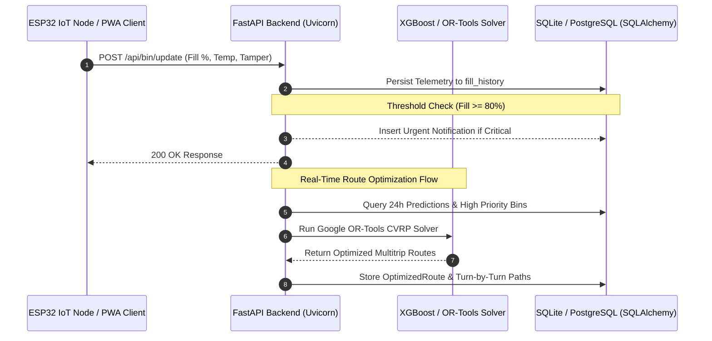

# EcoBin REST API Specification & Architecture

The EcoBin Smart Waste Management Platform is powered by an asynchronous **FastAPI** backend exposing over 40 production-grade RESTful endpoints organized into modular domains.

---

## 1. System Communication Architecture

---

## 2. API Endpoints by Domain

### 1. IoT Hardware & Bin Telemetry
| Method | Endpoint | Description | Request / Query | Response |
| :--- | :--- | :--- | :--- | :--- |
| `POST` | `/api/bin/update` | Ingests real-time IoT edge telemetry (ESP32 / Wokwi) | JSON with `bin_id`, `fill_percentage`, `battery_level`, `temperature` | `{"status": "success", "bin_id": ...}` |
| `GET` | `/api/bins` | Returns all municipal bins, optionally filtered by city | `?city=Hyderabad` | Array of `Bin` entities with GPS & fill |
| `GET` | `/api/bins/live` | Stream of live telemetry with latest sensor ping | `?city=Hyderabad` | Array of live bin status objects |
| `GET` | `/api/bins/{bin_id}` | Retrieve comprehensive telemetry history for a specific bin | Path param: `bin_id` | Bin object + historical graph data |
| `POST` | `/api/bins` | Registers a new physical or virtual bin container | JSON `BinCreate` | Created `Bin` entity |
| `PUT` | `/api/bins/{bin_id}` | Update bin capacity, coordinates, or maintenance state | JSON `BinUpdate` | Updated `Bin` entity |

### 2. Machine Learning & Forecasting
| Method | Endpoint | Description | Request / Query | Response |
| :--- | :--- | :--- | :--- | :--- |
| `POST` | `/api/predict` | Executes XGBoost Regressor to predict 24h fill progression | None (auto-ingests 14-day history) | `{"message": "Generated predictions for 403 bins."}` |
| `GET` | `/api/predictions` | Fetches latest 24h predictions with overflow risk probability | `?city=Hyderabad` | Array of predictions with `priority_score` |
| `POST` | `/api/train` | Triggers model re-training and baseline comparison | None | Model performance metrics (R², RMSE, MAE) |

### 3. Route Optimization & CVRP Solvers
| Method | Endpoint | Description | Request / Query | Response |
| :--- | :--- | :--- | :--- | :--- |
| `POST` | `/api/optimize` | Solves multi-truck Capacitated Vehicle Routing Problem | `?city=Hyderabad` | Optimized route assignments per fleet truck |
| `GET` | `/api/routes` | Returns today's active fleet routes with street polylines | `?city=Hyderabad&mode=cvrp` | List of routes, stop order, distance & fuel |
| `GET` | `/api/routes/compare`| Benchmarks 4 algorithms (OR-Tools vs GA vs SA vs Greedy) | `?city=Hyderabad` | 4-solver comparison with runtime (ms) & distance |

### 4. AI Waste Vision & Classification (YOLOv8)
| Method | Endpoint | Description | Request / Query | Response |
| :--- | :--- | :--- | :--- | :--- |
| `POST` | `/api/classify/image` | Classifies uploaded garbage photo via multipart form | File: `multipart/form-data` | Detected class, bounding boxes, bin assignment |
| `POST` | `/api/classify/base64`| Classifies base64 webcam / mobile capture snapshot | JSON: `{"image_base64": "..."}` | Segregation instructions, carbon factor, weight |
| `GET` | `/api/classify/logs` | Retrieves recent classification audit logs | `?limit=50` | Array of AI inspection audit records |
| `GET` | `/api/classify/categories`| Supported waste categories and municipal guidelines | None | Category list (Plastic, Organic, E-Waste, etc.) |

### 5. Circular Economy & Material Recovery Facilities (MRF)
| Method | Endpoint | Description | Request / Query | Response |
| :--- | :--- | :--- | :--- | :--- |
| `GET` | `/api/circular/facilities` | Registered recycling centers, composters, and MRF hubs | `?city=Hyderabad` | List of facilities with capacities and utilization |
| `POST` | `/api/circular/facilities`| Registers a new recycling or material recovery facility | JSON `RecyclingFacilityCreate` | Created facility record |
| `GET` | `/api/circular/materials` | Feed of materials diverted into the circular economy | `?city=Hyderabad` | Batches of flaked PET, compost, PCB copper |
| `POST` | `/api/circular/materials`| Logs newly recovered batch with buyer industry | JSON `MaterialRecoveryCreate` | Calculated CO2 offset and revenue generated |
| `GET` | `/api/circular/metrics` | Aggregated circular economy statistics & diversion rate | `?city=Hyderabad` | Tonnes diverted, revenue in ₹, landfill diversion % |
| `POST` | `/api/ai/segregation-chat`| Expert AI chatbot for CPCB segregation compliance | JSON: `{"query": "battery"}` | Bin color, handling protocol, circular destination |

### 6. Citizen Civic Hub & E-Waste
| Method | Endpoint | Description | Request / Query | Response |
| :--- | :--- | :--- | :--- | :--- |
| `GET` | `/api/citizen/reports` | Public feed of crowdsourced dumping & e-waste requests | `?city=Hyderabad` | Array of citizen reports with GPS coordinates |
| `POST` | `/api/citizen/reports` | Submits e-waste pickup request or illegal dump report | JSON `CitizenReportCreate` | Success confirmation + EcoPoints awarded |
| `PATCH`| `/api/citizen/reports/{id}`| Updates report status (Pending, Dispatched, Resolved) | JSON `{"status": "Resolved"}`| Updated report record |

### 7. Fleet Management, Driver PWA & QR Identity
| Method | Endpoint | Description | Request / Query | Response |
| :--- | :--- | :--- | :--- | :--- |
| `GET` | `/api/trucks` | Municipal collection fleet vehicle registry | `?city=Hyderabad` | List of trucks, capacity, fuel type, assigned driver |
| `POST` | `/api/driver/login` | Driver PIN / credential authentication | JSON `{"driver_id": "...", "pin": "..."}` | Driver session token & truck pairing |
| `GET` | `/api/driver/{truck_id}/route`| Turn-by-turn mobile navigation route for driver | Path: `truck_id` | Sequence of bins to collect with GPS coordinates |
| `POST` | `/api/driver/collect` | Confirms physical bin collection with QR verification | JSON `{"truck_id": "...", "bin_id": "..."}`| Verified collection log & bin fill reset to 0% |
| `POST` | `/api/qr/generate` | Generates tamper-proof cryptographic QR token | JSON `{"entity_type": "Bin", "entity_id": "..."}`| Active QR token string |
| `POST` | `/api/qr/scan` | Validates scanned QR token during physical collection | JSON `{"token": "..."}` | Verification result |

### 8. Maintenance & Field Technician Management
| Method | Endpoint | Description | Request / Query | Response |
| :--- | :--- | :--- | :--- | :--- |
| `GET` | `/api/maintenance/jobs`| Scheduled and active hardware maintenance work orders | `?city=Hyderabad` | List of work orders with technician assignments |
| `POST` | `/api/maintenance/jobs`| Dispatches a new repair job for damaged sensor or lid | JSON `MaintenanceJobCreate` | Created job ticket |
| `PUT` | `/api/maintenance/jobs/{id}`| Updates job status (In Progress, Resolved, Closed) | JSON `JobStatusUpdate` | Updated work order |
| `GET` | `/api/maintenance/stats`| Fleet-wide hardware health and MTTR metrics | `?city=Hyderabad` | Sensor uptime %, pending repairs, open tickets |

### 9. ESG Impact & Hackathon Victory Evaluation
| Method | Endpoint | Description | Request / Query | Response |
| :--- | :--- | :--- | :--- | :--- |
| `GET` | `/api/impact/summary` | Real-time verified carbon, fuel, and financial savings | `?city=Hyderabad` | Distance saved, fuel conserved, CO2 offset, ROI |
| `GET` | `/api/hackathon/summary`| Official EcoLogic 1.0 Hackathon Victory Scorecard | `?city=Hyderabad` | 6-metric golden scorecard across 5 themes |
| `GET` | `/api/reports/daily` | Comprehensive executive daily collection PDF/JSON report| `?city=Hyderabad` | High-level municipal daily summary |
| `GET` | `/api/cities` | List of supported metropolitan municipal corporations | None | 8 major Indian cities with coordinates & bin counts |
| `GET` | `/api/health` | System health check and database connectivity probe | None | `{"status": "healthy", "service": "ecobin-backend"}` |
