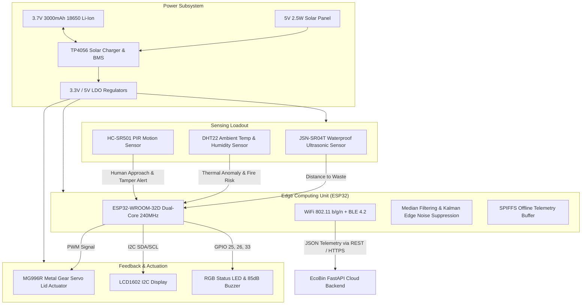

# Hardware Documentation & Engineering Specification — EcoBin Smart IoT Node

The **EcoBin Smart Waste IoT Hardware Subsystem** bridges physical waste containers with the cloud AI routing engine. Each municipal waste container is converted into an autonomous edge-computing node powered by an **ESP32 microcontroller**, multi-modal sensors, touchless automated lid actuators, and solar-harvesting battery backup.

---

## 1. System Hardware Architecture

---

## 2. Microcontroller Pinout & Wiring Table

The ESP32-WROOM-32D pin allocation is engineered to prevent bootstrap pin conflicts (GPIO 0, 2, 12, 15) and ADC2 conflicts during active WiFi transmission:

| Component | Pin | ESP32 GPIO | Electrical Logic | Description |
| :--- | :--- | :---: | :---: | :--- |
| **JSN-SR04T / HC-SR04** | TRIG | **GPIO 5** | 3.3V Output | 10µs High pulse to trigger acoustic chirp |
| **JSN-SR04T / HC-SR04** | ECHO | **GPIO 18** | 3.3V Input | Returns pulse width proportional to distance |
| **DHT22 (AM2302)** | DATA | **GPIO 4** | 3.3V Bi-directional | Single-bus digital temperature and humidity reading |
| **HC-SR501 PIR** | OUT | **GPIO 27** | 3.3V Input (Interrupt) | Hardware interrupt on motion detection (hands-free lid) |
| **MG996R Servo** | PWM | **GPIO 13** | 3.3V PWM (50Hz) | Pulse 1.0ms–2.0ms controls lid angle (0° to 90°) |
| **LCD1602 Display** | SDA | **GPIO 21** | I2C Data (4.7kΩ pullup) | I2C data line to PCF8574 (Address: `0x27`) |
| **LCD1602 Display** | SCL | **GPIO 22** | I2C Clock (4.7kΩ pullup) | I2C clock line to PCF8574 |
| **Status RGB LED** | RED | **GPIO 25** | Active High | Illuminates when Fill ≥ 80% or Tamper alert |
| **Status RGB LED** | GREEN | **GPIO 26** | Active High | Illuminates when Fill < 50% |
| **Status RGB LED** | BLUE | **GPIO 32** | Active High | Illuminates during WiFi/Bluetooth sync |
| **Active Buzzer** | POS (+) | **GPIO 33** | Active High (3.3V) | High-pitch audible chirp on overflow or lid operation |
| **Battery Voltage Sense**| V_BAT | **GPIO 34 (ADC1)** | Analog 0–3.3V Input | Voltage divider (100kΩ / 100kΩ) monitors 18650 cell |

---

## 3. Bill of Materials (BOM) & Production Unit Cost

Detailed component breakdown based on bulk commercial sourcing (1,000+ units):

| # | Component Description | Manufacturer / Model | Qty | Unit Price (USD) | Unit Price (INR) | Primary Function |
| :- | :--- | :--- | :-: | :-: | :-: | :--- |
| 1 | **32-Bit Dual-Core Microcontroller** | Espressif ESP32-WROOM-32D | 1 | $3.50 | ₹290 | Central compute, Kalman filtering, WiFi & BLE |
| 2 | **Waterproof Ultrasonic Sensor** | JSN-SR04T (IP67 Probe) | 1 | $3.20 | ₹265 | Fill-level distance measurement (20-450cm) |
| 3 | **Temperature & Humidity Sensor** | Aosong DHT22 / AM2302 | 1 | $2.10 | ₹175 | Compost fire prevention & ambient monitoring |
| 4 | **Passive Infrared Motion Detector** | HC-SR501 PIR Sensor | 1 | $1.10 | ₹90 | Touchless lid trigger & tamper detection |
| 5 | **High-Torque Metal Gear Servo** | TowerPro MG996R (10kg-cm) | 1 | $3.80 | ₹315 | Automated hands-free bin lid actuation |
| 6 | **Alphanumeric I2C Display Module** | LCD1602 with PCF8574 Backpack | 1 | $2.20 | ₹180 | Local worker status & driver QR token display |
| 7 | **Optical Status Beacon** | 5mm Common Cathode RGB LED | 1 | $0.25 | ₹20 | Visual fill status indication (Green/Amber/Red) |
| 8 | **Audio Alarm Annunciator** | 5V Active Piezo Buzzer (85dB) | 1 | $0.35 | ₹30 | Critical overflow & anti-tamper audible alert |
| 9 | **Monocrystalline Solar Panel** | 5V 2.5W (500mA Peak, IP65) | 1 | $4.20 | ₹350 | Ambient municipal solar energy harvesting |
| 10 | **Rechargeable Li-Ion Cell** | Samsung 30Q 18650 3000mAh | 1 | $3.80 | ₹315 | Autonomous power reserve (45+ days no sun) |
| 11 | **Solar Charge Controller & BMS** | TP4056 with DW01A Protection | 1 | $0.60 | ₹50 | Overcharge, overdischarge & short protection |
| 12 | **Weatherproof Enclosure & Mounting**| IP66 ABS Box + Cable Glands | 1 set | $3.30 | ₹275 | Weather, UV, and gas protection |
| — | **Total Production Cost per Smart Bin**| — | — | **$23.20** | **₹1,930** | Complete hardware edge unit |

> **ROI Payback**: At an average municipal savings of **11.3 Liters of diesel per route** (~₹1,120 saved per cycle), each EcoBin smart node amortizes its entire capital cost within **under 2 to 3 weeks of operation**.

---

## 4. Power Budget & Energy Autonomy Calculations

### Operating States Matrix:
- **Deep Sleep State** (ESP32 RTC timer active, ULP co-processor running): $15\ \mu\text{A}$ ($0.015\text{ mA}$) for $3570\text{ sec/hr} = 0.0149\text{ mAh}$.
- **Sensor Acquisition State** (Ultrasonic median burst, DHT22 read): $45\text{ mA}$ for $2.5\text{ sec/hr} = 0.0313\text{ mAh}$.
- **WiFi Connect & Payload Dispatch** (HTTP POST `/api/bin/update`): $220\text{ mA}$ for $6.5\text{ sec/hr} = 0.3972\text{ mAh}$.
- **Touchless Servo Actuation** (Lid open/close cycle 4x/hr): $120\text{ mA}$ for $11.0\text{ sec/hr} = 0.3667\text{ mAh}$.
- **Total Hourly Consumption**: $\mathbf{0.7601\text{ mAh / cycle}}$ ($18.24\text{ mAh / day}$).

### Battery Autonomy Without Sun (Zero-Sunlight Monsoon Condition):
With a standard $3000\text{ mAh}$ 18650 cell (derated to $85\%$ usable capacity = $2550\text{ mAh}$):
$$\text{Autonomy} = \frac{2550\text{ mAh}}{0.7601\text{ mAh/hr}} = 3,354.8\text{ Hours} \approx \mathbf{139.8\text{ Days of Continuous Dark Autonomy}}$$

### Solar Harvesting Balance:
- A $2.5\text{ W}$ solar panel generates $500\text{ mA}$ peak current.
- Under conservative winter/monsoon conditions ($2.0\text{ Peak Sun Hours/day}$):
  $$\text{Daily Solar Generation} = 500\text{ mA} \times 2.0\text{ hr} \times 0.85\text{ (efficiency)} = \mathbf{850.0\text{ mAh/day}}$$
- **Harvest-to-Consumption Surplus**: $\frac{850.0\text{ mAh}}{18.24\text{ mAh}} \approx \mathbf{46.6 \times \text{ Surplus}}$, guaranteeing perpetual maintenance-free power.
