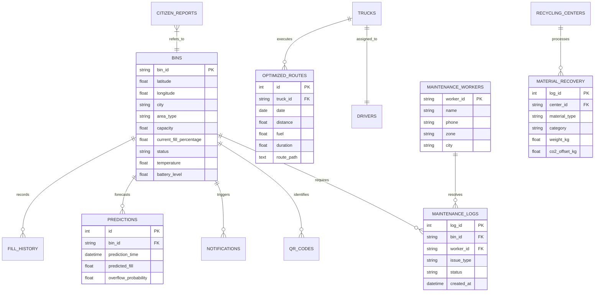

# Software Design Specification (SDS) — EcoBin System

**Architecture Style:** Modular Micro-Monolith with Decoupled REST Presentation & WebSocket Broadcast  
**Backend Framework:** FastAPI (Python 3.11, Uvicorn, SQLAlchemy 2.0) — *Deploy to Render*  
**Frontend Framework:** React 18, TypeScript 5.5, Vite, Leaflet, Recharts — *Deploy to Vercel*  

---

## 1. High-Level System Architecture

```mermaid
graph TD
    subgraph Presentation["Presentation Tier (Vercel / React 18 PWA)"]
        React[Admin Command Center - 16 Tabs]
        Leaflet[Leaflet.js Multi-City Geospatial Grid]
        Recharts[Recharts SVG ESG & Algorithm Visualizer]
        DriverPWA[Sanitation Driver Navigation PWA /driver]
        MaintPWA[Field Technician Diagnostic PWA /maintenance]
        CitizenHub[Citizen Civic & E-Waste Hub]
    end

    subgraph Service["Application Core Tier (Render / FastAPI 0.104+)"]
        FastAPI[FastAPI Asynchronous API Gateway]
        MLService[XGBoost Forecasting Engine - 24h Horizon]
        VRPService[Google OR-Tools CVRP Solver Engine]
        VisionService[YOLOv8 Computer Vision Classifier]
        ImpactService[ESG Carbon Accounting & ROI Engine]
        AuthService[Cryptographic QR Token & Driver Validator]
        WSManager[WebSocket Live Broadcast Grid /ws/live]
    end

    subgraph Hardware["IoT Hardware & Edge Tier"]
        ESP32[ESP32-WROOM-32D Dual Core MCU]
        JSN[JSN-SR04T Waterproof Ultrasonic Sensor]
        DHT[DHT22 Thermal Anomaly & Fire Sensor]
        Servo[MG996R Touchless Lid Actuator]
        Solar[5V Solar Panel + TP4056 BMS + 18650 Li-Ion]
    end

    subgraph Data["Persistence Tier"]
        SQLAlchemy[SQLAlchemy 2.0 ORM with Connection Pooling]
        DB[(SQLite / PostgreSQL Database)]
        Models[Trained Pickle Weights & Metadata]
    end

    Hardware -->|HTTP POST /api/bin/update (<15ms)| FastAPI
    Presentation <-->|HTTPS / REST / JSON| FastAPI
    Presentation <-->|WebSocket /ws/live| WSManager
    FastAPI --> MLService
    FastAPI --> VRPService
    FastAPI --> VisionService
    FastAPI --> ImpactService
    FastAPI <--> SQLAlchemy
    SQLAlchemy <--> DB
    MLService <--> Models
```

---

## 2. Database Schema & Entity Relationships

The relational schema is defined via SQLAlchemy ORM models supporting multi-city partitions:



---

## 3. Real-Time WebSocket Telemetry Protocol

EcoBin employs an asynchronous WebSocket broadcast pipeline (`/ws/live`):

```json
{
  "event": "BIN_TELEMETRY_UPDATE",
  "data": {
    "bin_id": "BIN042",
    "city": "Hyderabad",
    "fill_percentage": 86.4,
    "battery_level": 94.2,
    "temperature": 32.1,
    "status": "Warning",
    "timestamp": "2026-09-28T10:30:00.000Z"
  }
}
```
